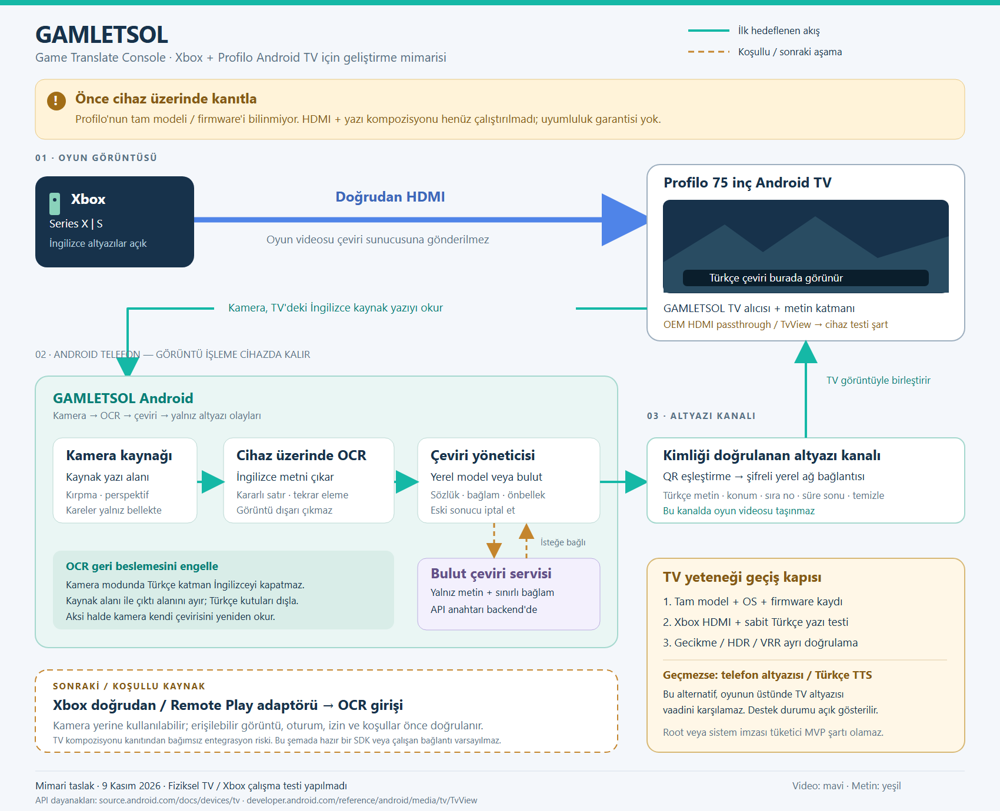
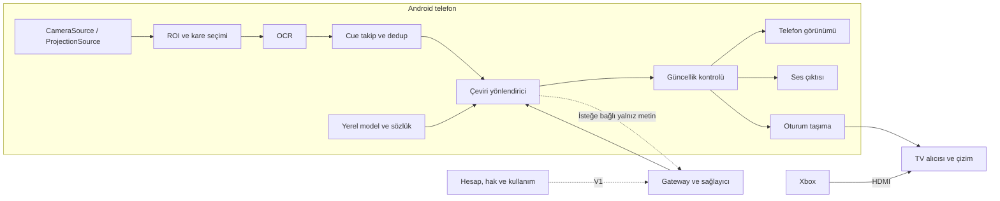
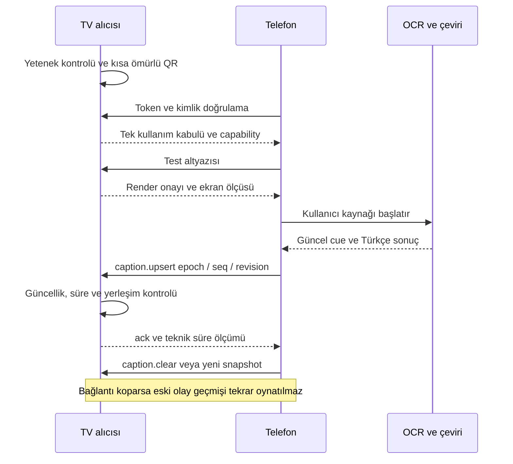
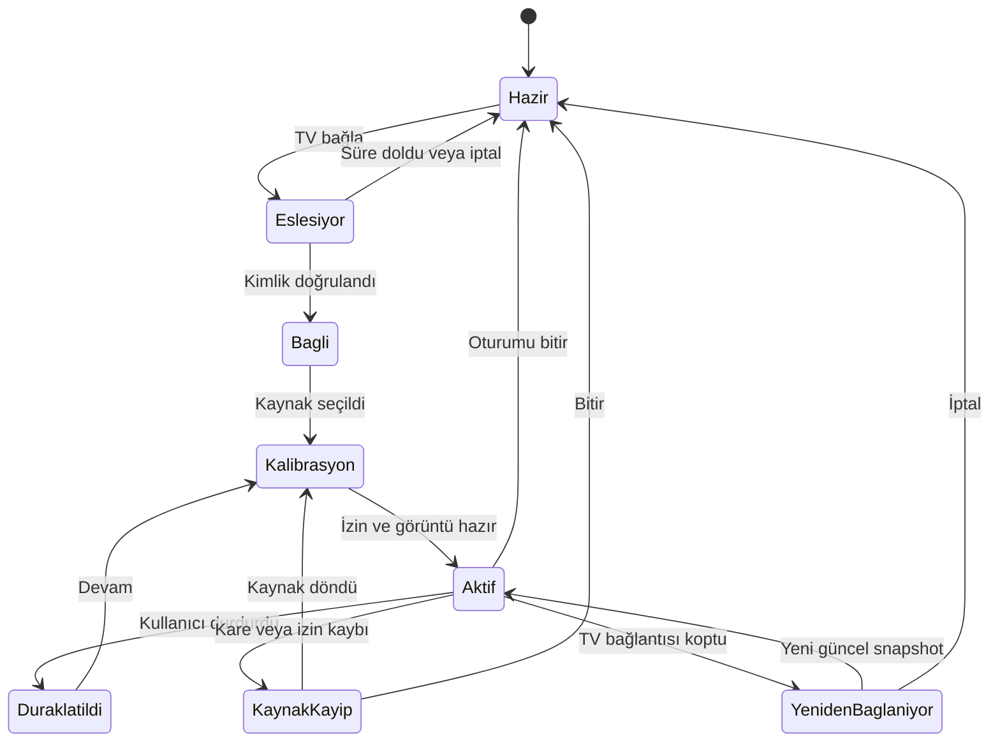
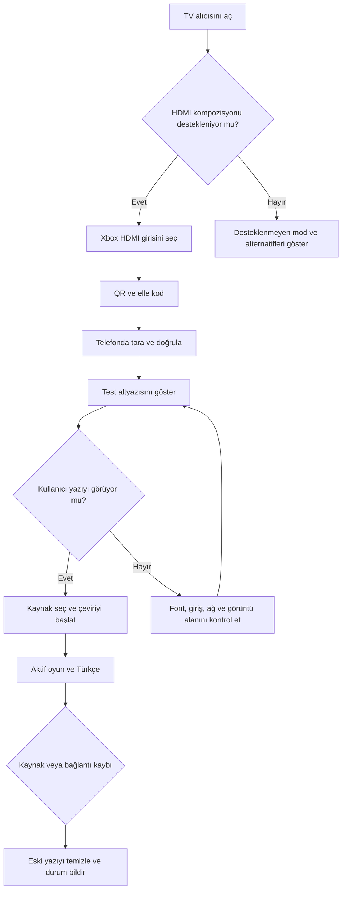
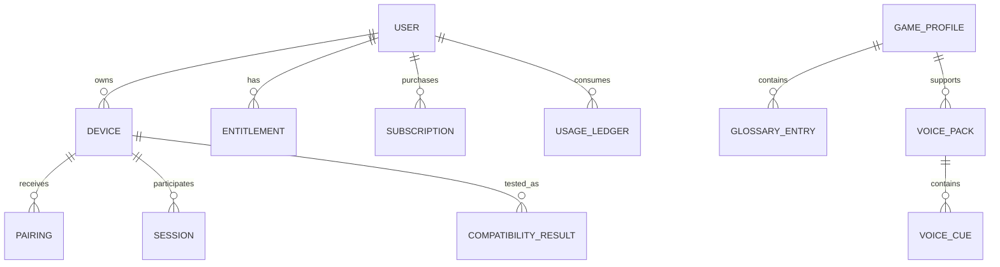
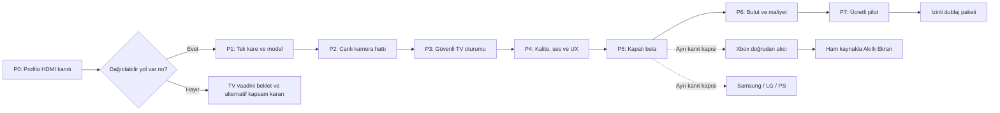

# GAMLETSOL geliştirme yol haritası ve mimarisi

**Game Translate Console · 9 Kasım 2026 · Tek geliştirici için proje planı**

GAMLETSOL'ün hedefi, İngilizce oyun yazılarını Android telefonda okuyup Türkçeye çevirerek kullanıcının oynadığı görüntüyle birlikte göstermektir. **İlk hedef donanımınız Xbox Series X/S ve 75 inç Profilo Android TV olmalı.** En önemli ilk iş, bu TV'de Xbox'ın gerçek HDMI görüntüsünün üzerine uygulama içinden yazı çizilebildiğini kanıtlamaktır. Telefon OCR'si, çeviri modeli ve QR eşleştirme kendi başına bu yeteneği sağlamaz. Bu belge bütün ürün kapsamını planlar; burada uygulama geliştirilmedi, konsol bağlantısı kurulmadı veya fiziksel TV testi yapılmadı. Platform bilgileri doküman araştırmasına; mimari, efor ve kalite eşikleri önerilere dayanır. Çekirdek ürün için **550 net saat**, yüzde 25 payla **687,5 saat**; haftada 25 üretken saatte **27,5 hafta, yaklaşık 6,3 ay** başlangıç tahmini kullanılmıştır.



## 1. Başlangıç kararı: önce kendi TV'nizde temel vaadi kanıtlayın

“Aynısı” hedefini, aynı kullanıcı ihtiyaçlarını karşılayan bağımsız bir ürün olarak ele alıyoruz. GAMLETSOL kendi kodunu, arayüzünü, görsellerini ve metinlerini kullanacak. Game Caption'ın tanıtımında Android/Google TV, Samsung kurulumu, LG tarayıcısı, konsol bağlantısı, Akıllı Ekran ve seslendirme bulunması özellik araştırmasına yardımcı olur; bu tanıtım GAMLETSOL'ün aynı erişimlere veya bütün cihazlarda aynı davranışa sahip olduğunu kanıtlamaz. Ürünün kendi gizlilik açıklaması Samsung kurulumunda cihaz sertifikasıyla ilgili bir akıştan, LG tarayıcı desteğinde ise test aşamasından söz ediyor. ([Game Caption](https://gamecaptionapp.com/), [gizlilik ve TV açıklamaları](https://gamecaptionapp.com/privacy))

Bu planın başlangıç varsayımı, temel Kotlin/Android geliştirmesini öğrenebilecek veya sürdürebilecek tek kişinin haftada 25 saat ayırmasıdır. Telefon modeli, Profilo'nun tam model kodu, Android sürümü, TV firmware'i ve Xbox'ın kesin modeli henüz bilinmiyor. Bunlar geliştirme başlamadan bir cihaz envanterine yazılmalı. TV'nin 75 inç olması API desteğini göstermez; Profilo adı belirli bir OEM yazılımı veya HDMI erişimi varsaymak için yeterli değildir.

İlk doğrulama uygulaması TV'de OEM'in bildirdiği HDMI girişlerini listeler. Uygun giriş varsa `TvInputManager`, `TvContract.buildChannelUriForPassthroughInput()` ve `TvView.tune()` ile Xbox görüntüsü uygulamanın içinde gösterilmeye çalışılır; üstüne sabit “GAMLETSOL bağlantı testi” yazısı çizilir. AOSP, üçüncü tarafların üreticinin passthrough TV girişlerini kullanabildiği mimariyi açıklar; doğrudan donanım katmanına erişim ise ayrıcalıklıdır. Bu nedenle hem “Android TV'de kesin olmaz” hem de “her Android TV'de kesin olur” yanlış başlangıçtır. ([AOSP TV Input Framework](https://source.android.com/docs/devices/tv), [TvView API](https://developer.android.com/reference/android/media/tv/TvView))

Prototipte özel sistem imzası, root veya tüketicinin edinemeyeceği üretici yetkisi gerekiyorsa normal dağıtılabilir TV ürünü kapısı geçilmiş sayılmaz. Geliştirici APK'sıyla görülen demo ile mağazadan kurulacak ürünün izinleri ayrı kaydedilir. Başarısızlık halinde telefon altyazısı ve sesli çeviriyle devam edilebilir; **bu alternatif, istediğiniz “TV'de oyunun üstünde çeviri” hedefinin tamamlandığı anlamına gelmez.**

## 2. Özellik kapsamı bütün ürünü kapsar, sürümlere ayrılır

MVP, ilk kullanılabilir dar üründür. Bu belgede MVP'nin TV vaadi ancak hedef modeldeki teknik kapı geçerse kullanılabilir. V1, bulut ve ücretli pilot; V2, kanıtlanan yeni platformlar ve gelişmiş özelliklerdir. Araştırma etiketi verilen işlerin tarihi, erişim ve prototip sonucu bilinmeden vaat edilmez.

| İstenen özellik | İlk kapsam | Sonraki kapsam / koşul |
|---|---|---|
| GAMLETSOL / Game Translate Console | Özgün isim, Türkçe arayüz, ürün kimliği | Yayından önce isim/marka kontrolü |
| TV'yi seç ve bağlan | Tek Profilo modelinde yerel keşif ve elle bağlantı | Model bazlı uyumluluk listesi |
| TV QR kodunu okut | Native TV alıcısında güvenli eşleştirme | Tarayıcı alıcısında farklı bağlantı akışı |
| Çeviriyi oyunun üzerinde gör | HDMI kompozisyon kapısı geçerse MVP | Desteklenmeyen TV'de açık alternatif mod |
| Kamerayı ekrana doğrult | MVP'nin ana görüntü kaynağı | Perspektif düzeltme ve gelişmiş takip |
| Xbox Series X/S bağlantısı | Resmî tarayıcı akışı + izinli ekran yakalama deneyi | Doğrudan alıcı ayrı araştırma ve lisans kapısı |
| PS5 / PS4 bağlantısı | İlk MVP dışında | Xbox pilotundan sonra kaynak adaptörü |
| Android TV / Google TV uygulaması | Dahili TV üzerinde tek model | Test edilmiş model/firmware ailesi genişletilir |
| Samsung Smart TV | Araştırma sonrası V2 alıcısı | TVWindow, gerçek cihaz ve dağıtım doğrulaması |
| Samsung'a telefondan kurulum | İlk sürüm dışında | Sertifika/dağıtım koşulları doğrulanırsa ayrı proje |
| LG 2021+ tarayıcı | Deneysel araştırma | Yıl bilgisi tek başına destek garantisi değildir |
| Diğer TV'lerde telefonda çeviri | MVP alternatif modu | Tablet ve ses çıktısı |
| Cihazda hızlı çeviri | İngilizce → Türkçe, model indirildikten sonra | Oyun sözlükleri ve kalite değerlendirmesi |
| Yapay zekâ/bulut çevirisi | V1; yalnız seçilen metin | Maliyet sınırı ve sağlayıcı kalite ölçümü |
| Serbest Çeviri | Oyun seçmeden kamera OCR | Film/dizi için yalnız erişilebilir ve okunabilir metin |
| Menü, envanter, görev, seçenekler | V2 önce kullanıcı tetiklemeli tarama | Sürekli Akıllı Ekran ayrı kalite kapısı |
| İngilizcenin üzerinde Türkçe | Dijital, overlay öncesi kaynakta hedef | Kamera modunda kaynak yazıyı kapatma sorunu çözülmeden vaat yok |
| Sesli çeviri | MVP sonuna doğru cihaz TTS'si | Bulut TTS ve TV ses çıkışı ayrı test |
| Seçili oyunlarda Türkçe seslendirme | İlk sürüm dışında | Hakları alınmış sürümlü oyun/ses paketi |
| Seslendirilen oyun listesi | Paket altyapısı gelince | Boş katalogda olmayan içerik gösterilmez |
| Küçük pencere | Kendi video yüzeyi mevcutsa V2 | Android PiP; TV HDMI overlay'inden farklıdır |
| Görüntünün sunucuya yüklenmemesi | Temel mimari koşulu | Ağ/log incelemesiyle doğrulanan gizlilik beyanı |

“Her oyunda” ifadesi, oyun adı seçmeden çalışmayı anlatabilir; bütün fontları, hızlı geçişleri, korumalı görüntüleri ve bütün cihazları kusursuz okuyacağı anlamına gelmez. Uygulama oyun içermez; kullanıcı oyununu kendi konsolunda açar ve İngilizce altyazıları etkinleştirir. Oyunda altyazı yoksa bu OCR ürünü kendiliğinden konuşmayı tanımaz; konuşma tanıma ayrı bir gelecek özelliği olur.

## 3. Platformların gerçek sınırları ürün tasarımını belirler

| Platform | Belgelenmiş temel | GAMLETSOL kararı |
|---|---|---|
| Profilo dahili Android TV | OEM passthrough girişleri üzerinden TvView yolu araştırılabilir | İlk fiziksel deney; destek henüz doğrulanmadı |
| Diğer dahili Android/Google TV | Aynı Android API ailesi, farklı üretici davranışı | Model bazlı test; genel garanti yok |
| Samsung Tizen | TVWindow ile HDMI kaynağı ve arkasında video/üstünde HTML kompozisyonu belgeli | İkinci TV ailesi adayı |
| LG tüketici TV tarayıcısı | Web motoru mevcut; genel HDMI overlay yolu bu araştırmada doğrulanmadı | Deneysel; 2021+ etiketi yeterli değil |
| Android TV kutusu / Chromecast | Kendi uygulama görüntüsünü gösterir | Başka HDMI portundaki Xbox'a doğrudan yazı eklemez |
| Telefon | Kamera, izinli ekran yakalama, kendi ekranında çizim | OCR/çeviri oturumunun başlangıç sahibi |

Samsung `TVWindow` ve overlay rehberi, HDMI görüntüsünü uygulamanın içine alıp üstüne HTML çizme yolunu açıklıyor. Bu, başka uygulamaların üzerine genel bir katman koymak veya HDMI piksellerini OCR için okumakla aynı değildir. Tizen uygulamasının sertifika, mağaza, ülke ve model grubu dağıtım koşulları da ayrıca doğrulanır. ([Samsung TVWindow](https://developer.samsung.com/smarttv/develop/api-references/tizen-web-device-api-references/tvwindow-api.html), [PiP overlay rehberi](https://developer.samsung.com/smarttv/develop/guides/pip-picture-in-picture/showing-pip-overlays.html), [dağıtım](https://developer.samsung.com/tv-seller-office/guides/applications/distributing-application.html))

LG'nin web motoru sürümü ve desteklenen web özellikleri modele/yıla göre değişir. Bir tarayıcının sayfa açması, HDMI üstünde çizim veya gereken WebCrypto/WebSocket davranışlarının çalışması demek değildir. Kamuya açık API listesinde doğrulanmayan yetenekler tüketici ürünü taahhüdüne dönüşmemeli. ([LG web motorları](https://webostv.developer.lge.com/develop/specifications/web-api-and-web-engine), [Luna API kapsamı](https://webostv.developer.lge.com/develop/references/luna-service-introduction))

Xbox Remote Play resmî olarak tarayıcı destekli cihazları kapsar. Bu ürünün varlığı, Android uygulamanıza gömülebilir alıcı SDK'sı verdiği anlamına gelmez. PS Remote Play de PS4/PS5 için resmî üründür; benzer entegrasyon ayrımı geçerlidir. ([Xbox Remote Play](https://www.xbox.com/en-US/consoles/remote-play), [PS Remote Play](https://www.playstation.com/en-us/remote-play/))

İlk Xbox deneyi resmî tarayıcı görüntüsünün kullanıcı izinli MediaProjection ile okunup okunamadığını sınar. `FLAG_SECURE` veya başka platform kısıtı varsa aşma yolu tasarlanmaz. Android, ekran yakalama için oturum başına izin ister; Android 15 QPR1+ cihazlarda ekran kilidi projeksiyonu durdurur. Telefonu kenara bırakmak ile ekranı kilitlemek aynı özellik değildir. ([MediaProjection](https://developer.android.com/media/grow/media-projection), [Play güvenli görüntü şartları](https://support.google.com/googleplay/android-developer/answer/16559646?hl=en))

Doğrudan konsol alıcısı için XStreaming ve Chiaki-ng araştırma adaylarıdır. İkisinin de kök lisansı AGPL-3.0'dır. Ücretli ürün geliştirmek tümden yasak değildir; kaynak sağlama, birleşik çalışma ve dağıtım koşulları gerçek entegrasyona göre incelenmelidir. JNI veya ayrı modül kullanmak bu değerlendirmeyi otomatik kaldırmaz. Açık kaynak stratejisi ya da uygun başka kullanım hakkı kararı verilmeden bileşen üretime gömülmemelidir. ([XStreaming lisansı](https://raw.githubusercontent.com/Geocld/XStreaming/main/LICENSE), [Chiaki-ng lisansı](https://raw.githubusercontent.com/chiaki-ng/chiaki-ng/main/COPYING), [GNU açıklamaları](https://www.gnu.org/licenses/gpl-faq.en.html))

## 4. Dört görüntü yolu birbirinden ayrı tasarlanmalı

**A — Yerel HDMI ve ayrı metin yolu**, ilk hedef mimaridir. Xbox görüntüsü doğrudan TV'ye gider. Telefon kameradan veya izinli dijital kaynaktan yazıyı okur; TV'ye yalnız çeviri olayını gönderir. TV, kendi OEM girişini uygulama içinde gösterebiliyorsa metni birleştirir. Görüntü buluttan geçmez. Game Mode, HDR, VRR, ALLM ve giriş gecikmesinin korunması ayrıca test edilir.

**B — Uygulama içinde video ve metin**, oyun videosunun da GAMLETSOL alıcısına geldiği yoldur. Aynı görüntü yüzeyinde altyazı çizmek kolaylaşır; karşılığında video taşıma, codec, kontrolcü ve gecikme yükü doğar. TV başka HDMI girişindeki görüntüyü izlemeyi bırakıp bu alıcıyı gösterir. Cast veya aynalama ancak oyun görüntüsünü de taşıyorsa bu mimariye yaklaşır; yalnız metin cast etmek A mimarisini oluşturmaz.

**C — Harici HDMI kompozitör**, konsol ile TV arasına görüntü ve yazıyı fiziksel olarak birleştiren cihaz koyar. Sıradan capture kartının passthrough çıkışı bu işi otomatik yapmaz. UVC uyumu, güç, desteklenen sinyal formatları ve gecikme ayrı donanım projesidir; solo Android MVP dışında tutulur. Korunan sinyali aşmak kapsam değildir. Android UVC desteği de cihazın USB host, kernel ve üretici kamera uygulamasına bağlıdır. ([AOSP USB kamera](https://source.android.com/docs/core/camera/external-usb-cameras))

**D — İkinci ekran ve ses**, telefon/tablet paneli veya TTS'dir. TV'ye erişim yokken işe yarar; ancak A'daki oyun üstü gösterim hedefini karşılamaz. Ürün içinde bu fark açık isimlerle görünmelidir.

```mermaid
flowchart TB
  subgraph A["A: Yerel HDMI ve ayrı metin — ilk hedef"]
    AX[Xbox] -->|HDMI video ve oyun sesi| AT[TV OEM giriş ve kompozisyon]
    AX -. Kamera veya izinli dijital kare .-> AP[Android OCR ve çeviri]
    AP -->|Yalnız altyazı olayları| AT
  end
  subgraph B["B: Uygulama içinde akış"]
    BX[Konsol] -->|İzinli video akışı| BR[Video alıcısı]
    BR -->|Kare örneği| BO[OCR ve çeviri]
    BR --> BC[Video ve metin kompozisyonu]
    BO --> BC
    BC --> BT[TV uygulama ekranı]
  end
  subgraph C["C: Ayrı donanım araştırması"]
    CX[Konsol] -->|HDMI| CC[Gerçek kompozitör]
    CP[Çeviri üreticisi] -->|Metin| CC
    CC --> CT[TV]
  end
  subgraph D["D: Alternatif deneyim"]
    DX[Konsol] --> DT[Normal HDMI TV]
    DP[Telefon OCR ve çeviri] --> DS[Telefon paneli veya TTS]
  end
```



## 5. Küçük ama genişleyebilir teknik temel

Önerilen tek teknoloji hattı **Kotlin, Jetpack Compose, Coroutines/Flow, CameraX, ML Kit Latin OCR, ML Kit İngilizce–Türkçe cihazda çeviri, Android TTS, Room, DataStore ve OkHttp WebSocket**. TV uygulaması Kotlin kullanır; TvView gerektiğinde Compose içine Android View olarak yerleştirilir. Arayüz ekranı ViewModel üzerinden durum üretir; görüntü hattı UI thread'inde çalışmaz. Bu seçim Android'in katman ayrımı ve tek yönlü veri akışı önerileriyle uyumludur. ([Android mimari önerileri](https://developer.android.com/topic/architecture/recommendations))

Başlangıç ürün sınırı olarak Android 8/API 26 düşünülebilir; bu bir kütüphane zorunluluğu değildir. Seçilen SDK sürümlerinin gerçek minimumu derlemede kontrol edilir. `targetSdk` ve mağaza gereksinimleri yayın tarihindeki güncel kurallara göre belirlenir. Sürümleri tahminen sabitlemek yerine bağımlılık kataloğu ve güncelleme politikası kullanılır.

Hesapsız yerel MVP sunucu gerektirmez. Bulut/abonelik geldiğinde **Kotlin Ktor modüler monolit + PostgreSQL + nesne depolama** seçilir. Böylece tek dil sürdürülür, API ve domain kodunun bakım maliyeti sınırlanır. İlk günden mikroservis, Kafka, Kubernetes veya ayrı vektör veritabanı kurulmaz. Redis ancak ölçülmüş çoklu instance/rate-limit ihtiyacı doğarsa eklenir.

```text
gamletsol/
  android/app-mobile/           telefon uygulaması
  android/app-tv/               doğrulanan Android TV alıcısı
  android/core/model/           olaylar ve değer tipleri
  android/core/pipeline/        cue yaşam döngüsü ve kararlar
  android/core/transport/       eşleştirme ve olay taşıma
  android/data/local/           Room, ayarlar, model yönetimi
  android/feature/capture/      CameraX ve izinli projeksiyon
  android/feature/session/      canlı oturum ve kullanıcı kontrolleri
  android/feature/speech/       TTS ve ileride paket oynatma
  android/feature/smart-screen/ kutular ve dönüşümler, sonraki faz
  backend/                     V1 gateway, kota ve ödeme doğrulama
  receivers/tizen/              koşullu V2
  receivers/web/                koşullu tarayıcı alıcısı
  contracts/                   JSON şemaları ve örnek olaylar
  tests/fixtures/              dağıtım hakkı olan test girdileri
  docs/                        kararlar, uyumluluk ve yayın kayıtları
```

Bu ağaç hedef sorumlulukları gösterir; her klasörü ilk gün ayrı Gradle modülü yapmak gerekmez. Başlangıçta uygulama, ortak çekirdek ve TV alıcısı yeterli olabilir. `FrameSource`, `TextRecognizer`, `Translator`, `SubtitleSink`, `SpeechOutput`, `SessionTransport` gerçek değişim noktalarıdır. İş kuralı konsol türünü, TV markasını veya bulut sağlayıcısını bilmez.



## 6. Kareden çeviriye işlem hattı

Her kare `sourceEpoch`, `frameId`, kaynak zaman damgası, genişlik/yükseklik, dönüş ve kaynak türü taşır. Kamera önizlemesi akıcı olabilir; OCR için her kareyi işlemek gerekmez. İlk ayar 3–5 OCR örneği/saniye olabilir, fakat gerçek cihaz ölçümüyle değiştirilir. CameraX'te `KEEP_ONLY_LATEST` yaklaşımı ve `ImageProxy.close()` kullanımı eski karelerin yığılmasını önler. ([CameraX analiz hattı](https://developer.android.com/media/camera/camerax/analyze))

Ön işlem önce dönüşü düzeltir, ardından kullanıcının seçtiği altyazı bölgesini, yani ROI'yi kırpar. Görüntü kararsızsa çeviri başlatılmaz. OCR metin bloklarını ve kutularını çıkarır; satırlar okuma sırasına göre birleştirilir. Küçük font, parlama, hareket bulanıklığı ve perspektif kaliteyi bozar. ML Kit'in görüntü kılavuzu yeterli karakter çözünürlüğü ve odağı vurgular; bu nedenle çözünürlüğü rastgele küçültmek hız kazandırırken anlamı kaybettirebilir. ([ML Kit OCR](https://developers.google.com/ml-kit/vision/text-recognition/v2/android))

Normalizasyon boşlukları ve satır kırımlarını düzenler; sayıları, eksi işaretini, yüzdeyi, tuş simgelerini ve kişi isimlerini körlemesine silmez. İki ardışık örnekte kararlılık ve kısa debounce başlangıç politikasıdır. Harf harf açılan altyazıda her ara metin ayrı çevrilmez. Kısa süre görünen cue'ların kaçırılma oranı ayrıca izlenir; yalnız uzun repliklerle başarı gösterilmez.

Kararlı metin `cueId` alır. Aynı sahne içindeki tekrar görüntü çeviri çağrısı üretmez. Aynı cümlenin farklı sahnede yeniden görünmesi ise sonsuza kadar engellenmez. Önbellek anahtarı dil çifti, normalleştirilmiş kaynak, oyun profili, sözlük sürümü, model sürümü ve bağlam stratejisini içerir. Oyun bağlamına bağlı sonuç başka sahneye gelişigüzel taşınmaz.

Çeviri sonucu geldiğinde hâlâ aynı epoch, cue ve revision geçerliyse gösterilir. Kullanıcı kaynağı değiştirmiş, menü kapanmış veya cue süresi bitmişse sonuç atılır; ses de oynatılmaz. Bir OCR işi ve sınırlı bekleyen son kare dışında kontrolsüz kuyruk kurulmaz. Sağlayıcı çağrısı iptal edilse bile ücretin iptal olduğu varsayılmaz. Ağ tekrarlarında `requestId` aynı tutulur; sunucu idempotency ile maliyeti ve kotayı tekilleştirir.

Kaynak yazı kaybolduğunda kısa tolerans sonrası `caption.clear` gönderilir. Örneğin 250–500 ms kayıp toleransı ve 2–6 saniyelik cue ömrü ilk ayardır, evrensel doğru değildir. TV bağlantısı kopsa dahi receiver kendi son kullanma zamanında yazıyı kaldırır. Ekranda saatlerce eski konuşma kalması bir hata kabul edilir.

**Kamera geri beslemesi özel olarak çözülmelidir.** Kamera TV'de çizilen Türkçeyi tekrar görür. Türkçeyi İngilizcenin üstüne opak koyarsanız kamera orijinal yazıyı okuyamaz. İlk kamera sürümünde İngilizce ROI ile Türkçe gösterim alanı ayrılır; overlay kutuları kamera koordinatlarına dönüştürülüp OCR'dan maskelenir. Kamera hareketi kalibrasyonu bozarsa kullanıcı yeniden hizalar. Overlay öncesi dijital kare Akıllı Ekran için daha güvenilir kaynaktır.

## 7. Akıllı Ekran ayrı bir ürün dilimidir

Altyazı çevirisi tek banttaki az sayıdaki satırı takip eder. Akıllı Ekran, menüdeki birçok kutunun yerini, kapsamını ve ömrünü yönetir. İlk sürüm kullanıcı tetiklediğinde mevcut ekranı analiz eden “Tara ve çevir” olmalıdır. Bu işlem konsoldaki oyunu durdurmaz; yalnız GAMLETSOL'ün aldığı görüntüyü işler. Sürekli hareketli HUD, harita, savaş içi sayılar ve animasyonlu envanter ilk kapsamın dışında tutulur.

Her metin bloğu `blockId`, kaynak metin, normalize kaynak kutusu, sahne kimliği, revision ve hedef metin taşır. Kaynak boyut, ROI ofseti, döndürme, letterbox, crop, TV'nin görüntü alanı ve kameranın perspektif dönüşümü tek bir `TransformChain` içinde yönetilir. 1080p kaynak kutusunu doğrudan 4K ekran pikseli gibi kullanmak yanlış hizalamaya yol açar. Kamera için dört köşe kalibrasyonu/homografi gerekir; hareket tespitinde eski matris geçersiz sayılır.

Türkçe genellikle farklı uzunluktadır. Yerleşim motoru önce satır kırar, sonra belirlenmiş minimuma kadar fontu küçültür; hâlâ sığmıyorsa geniş açıklama paneli gösterir. Anlamı modelle keyfî kısaltmak varsayılan çözüm değildir. Kutular buton ikonlarını, hedef işaretini veya önemli oyun bilgisini örtemez. İngilizceyi tamamen kapatma sadece ham dijital kaynağın ve hizalamanın güvenilir olduğu modda açılır.

Sahne değiştiğinde eski blokların tümü temizlenir. Aynı metin yeni koordinata taşınmışsa yalnız yerleşim güncellenir. Görünmeyen bloklar kaldırılır; görünmeyen metni tahmin ederek tamamlamak yapılmaz. Profesyonel paket hakkı bu işlevi açabilir, fakat ödeme yapılmış olması teknik uyumluluk kapısını atlatmaz.

## 8. Eşleştirme, olay protokolü ve oturum güveni

TV alıcısı önce yeteneklerini bildirir: `externalHdmiCompose`, `displayResolution`, `coordinateSpace`, `maxTextBlocks`, `ttsAudio`, `transport`, `protocolVersion`. Bunlar GAMLETSOL'ün önerilen alanlarıdır; üretici standardı değildir. Native alıcı yerel ağda NSD ile keşfedilebilir; görünen cihaz adı kimlik doğrulama değildir. Keşif çalışmazsa QR/elle bağlantı yolu bulunur. Misafir ağı, AP isolation ve farklı subnet durumları kullanıcıya anlaşılır şekilde açıklanır. ([Android NSD](https://developer.android.com/develop/connectivity/wifi/use-nsd))

QR; protokol sürümü, eşleştirme kimliği, alıcı adresi, sertifika/anahtar fingerprint'i ve en az 128 bit rastgele tek kullanımlık token taşır. Önerilen ömür 60 saniyedir. Telefon yalnız beklenen şemayı kabul eder; kullanıcı TV'deki kısa doğrulama kodunu karşılaştırır. Token tüketildiğinde tekrar kullanılamaz, yarışan ikinci telefon reddedilir. TLS fingerprint doğrulaması yapılır; bütün sertifikaları kabul eden geliştirme kodu üründe kalmaz. Hatırlanan cihaz yetkisi açık kullanıcı seçimiyle saklanır ve iptal edilebilir. ([Android ağ güvenliği](https://developer.android.com/privacy-and-security/security-config), [Keystore](https://developer.android.com/privacy-and-security/keystore))

Tarayıcı alıcısı için HTTPS sayfa ve WSS relay gerekebilir. Böyle bir mod internet ister; tamamen yerel diye tanıtılmaz. TLS aktarımı şifreler ama sunucunun metni göremediği anlamına gelmez. Uçtan uca şifreleme ayrıca doğrulanmış protokol ve anahtar yönetimi gerektirir. Bulut çevirisinde kaynak metnin sağlayıcı tarafından işlenmesi ise bu ayrımdan bağımsızdır. Güncel Android yerel ağ izinleri hedef SDK'ya göre ayrıca uygulanır. ([Android yerel ağ izni](https://developer.android.com/privacy-and-security/local-network-permission))



Örnek olay, uygulanacak sözleşmenin başlangıcıdır:

```json
{
  "schemaVersion": 1,
  "sessionId": "5e8c-local-session",
  "sourceEpoch": 3,
  "seq": 129,
  "eventId": "evt-129",
  "kind": "caption.upsert",
  "cueId": "cue-42",
  "revision": 2,
  "sourceFrameId": 8401,
  "sourceTimeMs": 28440,
  "expiresAtSessionMs": 32200,
  "sourceSize": {"width": 1920, "height": 1080},
  "mode": "subtitle",
  "blocks": [{
    "id": "b1",
    "bbox": {"x": 0.16, "y": 0.80, "width": 0.68, "height": 0.10},
    "text": "Eğilin. Bizi henüz görmediler.",
    "language": "tr"
  }]
}
```

`seq` oturum içinde monoton artar, `sourceEpoch` kaynak değişiminde artar, `revision` aynı cue'nun düzeltmesini belirtir. Alıcı yinelenen/eski mesajı düşürür. `text` HTML olarak çalıştırılmaz. Diğer olaylar `caption.clear`, `layout.snapshot`, `session.state`, `speech.play`, `speech.stop`, `ping/pong`, `ack`, `error` olur. Şema uzunluk, kutu aralığı ve blok sayısı sınırı koyar.

Telefon ve TV'nin monoton saatleri doğrudan aynı kabul edilmez. Handshake ve ping örnekleriyle ortak oturum zamanı/ofset belirsizliği hesaplanır. Alıcı süreyi kalan ömürle sınırlar; sırf yeniden bağlandı diye eski cue'ya yeni tam TTL vermez. Saat belirsizliği güvenilir eşikten büyükse kısa metin atılır ve yeni snapshot istenir. Reconnect artan bekleme ve jitter kullanır; kullanıcı durdurduğunda yeniden bağlanma iptal edilir.



## 9. Telefon ve TV ekranları kullanıcıya gerçek durumu göstermeli

Telefon uygulamasında aşağıdaki 14 ekran/sayfa yeterli bir başlangıç bilgi mimarisidir. Bazıları tam sayfa yerine alt panel olabilir; ayrı ekran sayısını yapay olarak artırmak gerekmez.

| Ekran | Ana içerik ve durumlar |
|---|---|
| 1 Karşılama | Ürünün yaptığı iş, görüntü kaynağı ve kısa gizlilik açıklaması |
| 2 Ana ekran | Çeviriyi başlat, son TV, model hazır mı, son kullanılan profil |
| 3 Kaynak seçimi | Kamera, izinli ekran, daha sonra doğrulanmış konsollar |
| 4 Kamera kurulumu | Odak, hizalama, ışık, TV köşeleri; izin reddi |
| 5 ROI ve kalibrasyon | İngilizce bölge ve Türkçe gösterim alanı ayrı |
| 6 TV seçimi | Bulunan/hatırlanan TV, elle bağlantı, destek durumu |
| 7 QR eşleştirme | Kod, süre dolması, yanlış TV, tekrar deneme |
| 8 Canlı oturum | Kaynak, çeviri ve TV durumları; duraklat/bitir |
| 9 Altyazı görünümü | Font, konum, kontrast, satır sayısı ve örnek metin |
| 10 Dil ve model yönetimi | İndir, boyut, ilerleme, yarıda kalma, çevrimdışı hazır |
| 11 Oyun profilleri | Serbest mod, terimler, ROI; oyun seçimi zorunlu değil |
| 12 Ses | Türkçe ses listesi, örnek dinle, ağ ihtiyacı, konuşma politikası |
| 13 Hesap ve paket | V1'de kullanım, abonelik, geri yükle, silme |
| 14 Destek ve tanılama | Teknik özet, uyumluluk, içeriksiz log dışa aktarma |

TV'de D-pad odakları belirgin olmalı; açılış, HDMI seçimi, QR, test yazısı, aktif gösterim, bağlantı kaybı ve ayarlar kumandayla tamamlanabilmeli. Geri tuşu yanlışlıkla konsol oturumunu kapatmamalı; “altyazıyı durdur” ile “TV uygulamasından çık” ayrılmalı. TV uygulaması çeviri yokken boş siyah ekran göstermemeli; HDMI kaynak durumu ve bağlantı açıklaması görünmelidir.



“TV bağlı”, “metin iletiliyor” ve “oyunun üzerinde gösterim destekleniyor” ayrı durumlardır. Hata mesajı yalnız kod göstermez: `MODEL_NOT_READY` için indirme, `SOURCE_LOST` için kamera/kaynak kontrolü, `PAIRING_EXPIRED` için yeni QR, `QUOTA_EXCEEDED` için yerel moda geçiş önerir. Kullanıcı kamera iznini reddettiyse sürekli izin penceresi açılmaz. TTS kullanmak için gereksiz mikrofon izni istenmez. Büyük yazı, Türkçe karakterler, TalkBack etiketleri, odak sırası ve renk dışı durum işaretleri kabul testinin parçasıdır.

## 10. Bulut, hesap ve ödeme çekirdek çalıştıktan sonra gelir

Çeviri yönlendiricisi önce güncel ve uygun önbelleği, sonra seçilmiş yerel modeli kullanır. Kullanıcı yüksek kalite modunu açarsa yalnız temizlenmiş metin ve sınırlı bağlam gateway'e gider. Yerel İngilizce/Türkçe modeller indirildikten sonra cihazda çalışabilir; Google özel kullanım alanlarında kalite ölçümünü önerir. “Cihazda” olması oyun terminolojisini kusursuz çevirdiği anlamına gelmez. ([ML Kit çeviri](https://developers.google.com/ml-kit/language/translation), [dil desteği](https://developers.google.com/ml-kit/language/translation/translation-language-support))

Gateway kimliği ve hakkı doğrular, karakter sınırını kontrol eder, atomik kota rezervasyonu oluşturur, `requestId` kaydını tekilleştirir, sağlayıcıyı çağırır ve tüketimi yalnız bir kez kesinleştirir. Kullanıcı, cihaz ve tüm servis için günlük sert bütçe sınırı bulunur. Alarm göndermek harcamayı durdurmak değildir. APK içine sağlayıcı sırrı konmaz. Rate limit, deadline, sınırlı retry ve circuit breaker uygulanır; backend arızasında önceden hazır yerel çeviri çalışabilir.

Genel dil modeli kullanılırsa oyun metni talimat değil veri kabul edilir. Modele araç, dosya veya hesap erişimi verilmez; yalnız çeviri döndürmesi beklenir. Çıktı şema/uzunluk doğrulamasından geçer. Kullanıcıdan veya OCR'dan gelen HTML çalıştırılmaz. Profil sözlüğü özel isimleri, tuşları, sayıları ve oyun terimlerini korur; kritik anlam terslikleri kalite raporunda ayrı tutulur.

| API önerisi | Amaç | Temel kontrol |
|---|---|---|
| `POST /v1/pairings` | Relay modunda eşleştirme oluştur | Kısa ömür, hız sınırı |
| `POST /v1/pairings/{id}/claim` | Tek kullanımlık eşleştirme | Atomik tüketim, alıcıya bağlama |
| `POST /v1/sessions` | Çevrimiçi oturum | Cihaz rolü ve protokol |
| `DELETE /v1/sessions/{id}` | Oturum sonlandır | Yayıncı yetkisi, token iptali |
| `WSS /v1/sessions/{id}/events` | Olay aktarımı | Rol, boyut, sıra ve süre kontrolü |
| `POST /v1/translations` | Bulut çeviri | Entitlement, idempotency, kota |
| `GET /v1/me/entitlements` | Kullanıcının hakları | Sunucu kaynağı |
| `GET /v1/me/usage` | Şeffaf kullanım sayacı | Kullanıcıya özel erişim |
| `POST /v1/purchases/verify` | Satın almayı doğrula | Mağazadan doğrulama |
| `POST /v1/store/notifications` | Yenileme/iade/iptal | İmza/kimlik ve tekrar kontrolü |
| `GET /v1/catalog` | Profil ve izinli ses paketleri | Sürüm ve hak durumu |
| `POST /v1/account/deletion` | Hesap silme talebi | Kimlik, iş durumu ve açıklanan saklama |

Native LAN eşleştirmesi bu sunucu uçlarına ihtiyaç duymayabilir. MVP'ye sırf tabloda var diye bütün endpoint'ler eklenmez. Hesap, bulut kota ve cihazlar arası hak taşımaya ihtiyaç doğunca açılır. Ücretli dijital özelliklerde uygulanabilir Google Play Billing kuralları izlenir. İstemcinin “premium=true” değeri güven kaynağı değildir; satın alma, yenileme, grace period, iptal, iade ve geri yükleme sunucuda işlenir. Tekrar gelen mağaza bildirimi hak veya kotayı iki kez artırmaz. ([Play Payments](https://support.google.com/googleplay/android-developer/answer/9858738?hl=en))

Önerilen paket ayrımı, ölçümden sonra kesinleşmek üzere, yerel temel çeviri; belirli bulut bütçeli yüksek kalite; doğrulanmış Akıllı Ekran ve daha yüksek kullanım hakkı içeren Profesyonel olabilir. İlk sürümde çok sayıda paket ve yıllık sınırsız söz verilmez. Kullanıcı satın almadan önce cihazının hangi TV modunu desteklediğini görmelidir.

## 11. Veri modeli ve saklama politikası

Canlı altyazı olayları kalıcı kullanıcı geçmişine otomatik yazılmaz. Telefonun kısa RAM önbelleği ile backend'in ödeme kayıtları farklı amaçlar taşır. İsteğe bağlı yerel geçmiş kullanıcı tercihiyle açılır; silinebilir ve varsayılan bulut senkronu yoktur.



ER şeması mantıksal ilişkiyi gösterir; hesapsız cihazda `owner_id` boş olabilir ve yerel kayıt backend'e taşınmaz. `Session` katılımı pratikte publisher/receiver rolleri olan ilişki tablosuyla tutulabilir. `UsageLedger.request_id` benzersizdir. Pairing tablosunda ham token yerine hash; abonelikte satın alma token'ı gerekiyorsa şifrelenmiş, dar erişimli kayıt kullanılır. `VoicePack` hak durumu, manifest hash'i, sürüm ve minimum uygulama sürümünü taşır.

| Veri | Varsayılan konum | Önerilen saklama ve silme |
|---|---|---|
| Kamera/oyun karesi | Telefon RAM | İşlem/sınırlı tampon sonrası bırak; disk ve upload yok |
| OCR ve Türkçe cue | RAM | Oturum bitince sil; TTL ile canlı çıktı temizlenir |
| Yerel geçmiş | Telefon özel alanı | Varsayılan kapalı; kullanıcı siler |
| Profil/sözlük/ayar | Room/DataStore | Kullanıcı silene veya sürüm değişene kadar |
| Eşleştirme sırrı | Güvenli cihaz deposu | İptal, yeniden kurulum veya anahtar değişiminde kaldır |
| Relay olayları | Geçici bellek | Gönderim/TTL sonrası; kalıcı metin tablosu yok |
| Teknik hata/performans | Redakte log | İlk öneri 14 gün; gerçek destek ihtiyacına göre açıklanır |
| Kullanım defteri | Backend | Kota ve itiraz için açıklanan dönem; metin içermez |
| Hesap/ödeme | Backend | Amaç ve ilgili saklama yükümlülüğüne göre ayrı takvim |
| İzinli ses dosyası | Depo/CDN/telefon | Paket sürümü ve hak süresi; geri çekme desteği |

“Görüntüler cihazda işlenir, çevrimiçi çeviride yalnız seçilen metin gönderilir” hedef beyanıdır; test edilmeden yayınlanmaz. OCR'a oyuncu adı veya sohbet yazısı girebilir; ROI sınırlandırılır. ML Kit'in görüntü/metin girdisini Google'a göndermeyen davranışı, SDK'nın hiç teknik veri işlemediği anlamına gelmez; model güncelleme ve telemetri açıklamaları incelenir. ([ML Kit koşulları](https://developers.google.com/ml-kit/terms), [veri açıklaması](https://developers.google.com/ml-kit/android-data-disclosure))

Data Safety üçüncü taraf SDK davranışlarını da kapsar. Hesap açılıyorsa uygulama içinden ve web üzerinden silme talebi yolu gerekir. Bulut sağlayıcının yurt dışı veri işlemesi, saklama ve sözleşme seçimini etkiler; gerçek veri akışına göre KVKK değerlendirmesi yapılır. Bunlar ürünün kullandığı akışlara bağlı yayın işleridir. ([Play Data Safety](https://support.google.com/googleplay/android-developer/answer/10787469?hl=en), [hesap silme](https://support.google.com/googleplay/android-developer/answer/13327111?hl=en-EN), [KVKK aktarım düzenlemeleri](https://www.kvkk.gov.tr/Icerik/7938/Standart-Sozlesmeler-ve-Baglayici-Sirket-Kurallarina-Iliskin-Dokumanlar-Hakkinda-Kamuoyu-Duyurusu))

## 12. Sesli çeviri ile oyun dublajı farklı geliştirilir

İlk ses özelliği, Türkçe metni cihazdaki uygun TTS sesiyle okumaktır. Android'de Türkçe sesin bulunması ve çevrimdışı çalışması motor/cihaza bağlıdır; sesler sorgulanır ve örnek dinletilir. Ağ isteyen ses açıkça belirtilir. Yeni cue geldiğinde eski replikler dakikalarca birikmez; varsayılan politika güncel kısa repliğe öncelik verir. Kullanıcı isterse mevcut cümleyi tamamlamayı seçebilir. ([Android TTS](https://developer.android.com/reference/android/speech/tts/TextToSpeech), [Voice ağ gereksinimi](https://developer.android.com/reference/android/speech/tts/Voice))

TV'nin HDMI sesiyle Türkçe TTS'yi karıştırabilmesi ayrı yetenektir. Telefon yalnız kendi sesini kontrol eder; konsolun İngilizce konuşmasını müzik ve efektlerden otomatik ayıracağı vaat edilmez. Oyun destekliyorsa kullanıcı diyalog sesini azaltabilir. Bluetooth gecikmesi, audio focus ve kulaklık takma/çıkarma ölçülür. Metin overlay testinin geçmesi TV ses miksinin de geçtiği anlamına gelmez.

Seçili oyun dublaj paketi için içerik hakkı, insan çeviri kontrolü, izinli ses üretimi/kayıt, ses normalizasyonu, cue eşleştirme, oyun sürümü QA'sı, imzalı manifest ve geri alma gerekir. Aynı İngilizce cümle farklı karakter/sahnede geçtiğinde yalnız metin hash'i yanlış sesi seçebilir; sahne/konuşmacı ve önceki cue bağlamı kullanılır. Güven düşükse yanlış dublaj yerine altyazı veya genel TTS çalışır. Önceden hazırlanmış ses de ancak altyazı görüldükten sonra tetikleniyorsa orijinal replikle aynı anda başlamayı garanti etmez.

Oyun metni ve ses paketini dağıtmak, kişisel anlık çeviriden farklı hak değerlendirmesidir. WIPO çeviri ve uyarlamayı hak sahibinin kontrol edebildiği kullanım alanları arasında açıklar. İlk katalog yalnız hakları doğrulanmış içerikle oluşturulur; orijinal oyuncu sesinin izinsiz klonlanması başlangıç ürününe eklenmez. ([WIPO telif açıklaması](https://www.wipo.int/en/web/copyright/faq-copyright))

## 13. Kalite hedefleri ölçümden önce vaat değildir

Başlangıç veri kümesi izinli test sahnelerinden 500–1000 altyazı cue'su ve 100–200 menü görüntüsü içermelidir. Ayar geliştirmede kullanılan sahnelerle görülmemiş test sahneleri ayrılır. Farklı oyun türleri, fontlar, koyu/açık sahne, iki konuşmacı, kısa replik, sayı/negasyon, kamera açısı ve ışık değerlendirilir. Dağıtım hakkı olmayan oyun kaydı repoya eklenmez.

| Ölçüm | Önerilen başlangıç kapısı | Nasıl doğrulanır? |
|---|---|---|
| OCR karakter hatası | Temiz dijitalde ≤%5; tanımlı kamera koşulunda ≤%10 | İnsan kaynak metniyle CER; kaynaklar ayrı |
| Anlam doğruluğu | En az %90 kabul edilebilir; kritik hata ayrı | En az 100 kör değerlendirilen cue |
| Yerel uçtan uca altyazı | p50 ≤700 ms, p95 ≤1500 ms | Orijinal görünürlükten TV render'a |
| Bulut uçtan uca altyazı | p50 ≤1200 ms, p95 ≤2500 ms | Aynı başlangıç/bitiş; sağlayıcı dahil |
| Yerel metin taşıma | p95 ≤150 ms | OCR/çeviriden ayrı |
| Eski sonuç | Senaryo testlerinde 0 stale cue | Geciktirilmiş/ters sıralı yanıtlar |
| Eşleştirme | 10/10 doğru; eski token 0 kabul | Süre aşımı, ikinci telefon ve replay |
| Uzun oturum | 60 dk crash yok; sürekli RAM büyümesi yok | Sonra 120 dk ısı/pil ölçümü |
| Gizlilik | Varsayılan kare upload'u ve içerik log'u 0 | Kontrollü ağ ve log incelemesi |
| HDMI gösterim | 30 dk gerçek Xbox + metin; giriş/geri tuşu çalışır | Fiziksel Profilo ve normal izin yolu |

Bu sayılar sağlanmış sonuç değil, ilk kalite sözleşmesi önerisidir. İlk ölçümden sonra kabul edilebilir kullanıcı deneyimiyle birlikte revize edilir; hedefi sessizce düşürüp başarı denmez. p95 uçtan uca ölçülür, aşamaların p95 değerleri toplanarak hesaplanmaz. Oyun kontrolcüsünden ekrana gecikme ayrı metriktir. HDMI'ı uygulama içinde gösterme yolu görüntü modunu değiştirirse oyun gecikmesi artabilir; “sıfır gecikme” yazılmaz.

Unit testler cue kararlılığı, dedup, epoch, süre, dönüşüm ve kota kararlarını kapsar. Sahte kaynak/sağlayıcı/alıcıyla pipeline entegrasyonu yapılır. Android yaşam döngüsü, izin reddi, model indiriminin kesilmesi, ekran kilidi, rotasyon ve ısı gerçek cihazda sınanır. Ağ kesilmesi, 429/5xx, bozuk JSON, saat farkı, TV uyku/uyanma, HDMI kaynak değişimi, bozuk ses paketi ve tekrar mağaza bildirimi hata matrisine girer. Mock test TV'nin gerçek HDMI yetkisini kanıtlamaz.

CI her değişiklikte derleme, lint ve anlamlı çekirdek testlerini çalıştırır. Release adayı imzalama sırları repoda bulunmaz; bağımlılık lisans envanteri tutulur. Tanılama yalnız kaynak türü, model hazır durumu, kuyruk uzunluğu, süre yüzdelikleri, hata kodu ve kaynak/receiver sürümünü toplar. Ham kare, replik, hesap token'ı ve sağlayıcı anahtarı destek log'una girmez.

## 14. Tek geliştirici için efor, sıra ve karar kapıları

Takvim net üretken saat üzerinden hesaplanır. Öğrenme, hata düzeltme ve yeniden çalışma için yüzde 25 pay ayrıca gösterilir. Cihaz edinme, mağaza incelemesi ve iş ortaklığı beklemesi bu saatlerin dışında takvimi uzatabilir. AI araçları kullanmak fiziksel cihaz doğrulamasını veya platform erişimini ortadan kaldırmaz.

| Faz | Kapsam | Net saat | 25 saat/hafta |
|---|---|---:|---:|
| P0 | Donanım/HDMI ve izin kanıtı, ilk tek kare dilimi | 50 | 2 |
| P1 | Uygulama temeli, model ve sabit görüntü hattı | 75 | 3 |
| P2 | Kamera, ROI, kararlılık, dedup ve expiry | 125 | 5 |
| P3 | Tek TV alıcısı, güvenli eşleştirme ve yaşam döngüsü | 100 | 4 |
| P4 | Profil, TTS, kullanıcı akışı ve ölçüm | 100 | 4 |
| P5 | Kapalı beta, cihaz matrisi ve temel yayın hazırlığı | 100 | 4 |
| **Çekirdek toplam** | **Hesapsız kamera + kanıtlanmış tek TV modeli** | **550** | **22** |
| P6 | Bulut gateway, hesap, kota ve maliyet | 100 | 4 |
| P7 | Ödeme hakları, geri yükleme ve ücretli pilot | 100 | 4 |
| **V1 birikimli** | **Çekirdek + bulut + ücretli pilot** | **750** | **30** |

Çekirdeğe yüzde 25 pay: `550 × 1,25 = 687,5 saat`; 25 saat/haftada `27,5 hafta ≈ 6,3 ay`. V1 birikimli paylı süre: `750 × 1,25 = 937,5 saat`; `37,5 hafta ≈ 8,6 ay`. Ay dönüşümü yaklaşık 4,35 hafta/ay kullanır. Bu tahmin deneyimli solo geliştiricinin dar kapsamına yöneliktir; Android/TV alanına yeni başlıyorsanız P0/P1 sonunda yeniden tahmin gerekir.

| Haftalık net kapasite | Çekirdek 687,5 saat | V1 toplam 937,5 saat |
|---|---:|---:|
| 10 saat | 68,75 hafta / yaklaşık 15,8 ay | 93,75 hafta / yaklaşık 21,6 ay |
| 25 saat | 27,5 hafta / yaklaşık 6,3 ay | 37,5 hafta / yaklaşık 8,6 ay |
| 40 saat | 17,19 hafta / yaklaşık 4 ay | 23,44 hafta / yaklaşık 5,4 ay |

Haftada 40 üretken saat, bilgisayar başında geçirilen 40 saatle aynı değildir. Destek, muhasebe, içerik üretimi ve platform sorunları kapasiteyi azaltır. Tüm konsollar, Samsung/LG, sürekli Akıllı Ekran, dublaj kataloğu ve cihaz laboratuvarı için yaklaşık **1.600–2.600 net saat**, yüzde 25 payla **2.000–3.250 saat** geniş kapsam modeli kullanılabilir. 25 saat/haftada 80–130 hafta, yaklaşık **18–30 ay** eder. Bu koşullu banttır; erişim izni çözülemeyen bir platform daha fazla saat harcanınca otomatik açılmaz.



İlk iki haftanın **50 saatlik** işi şu şekilde sınırlandırılır:

| İş | Saat | Somut çıktı |
|---|---:|---|
| Telefon/TV/Xbox envanteri ve hedef senaryo | 4 | Model, OS, firmware, HDMI portu kaydı |
| Android/TV test proje ve kurulum yolu | 6 | Açılan minimal APK ve izin kaydı |
| Profilo input listeleme ve HDMI + sabit metin | 12 | Çalışır/engelli sonucu, 30 dk deney |
| Görüntü modu, kumanda ve normal kurulum sınırı | 6 | 1080p60 temel sonuç, gelişmiş modlar ayrı |
| Telefonda tek kare OCR + en-tr model | 8 | Gerçek kaynak metni ve çevrimdışı Türkçe |
| Basit telefon→TV metin deneyi | 6 | Dinamik metin; üretim güvenliği tamamlandı sayılmaz |
| Kaynak/overlay alanı ve geri besleme deneyi | 4 | Birbirini örtmeyen ROI/gösterim |
| Sonuç raporu ve devam/ertele kararı | 4 | Kanıt, engel, güncellenmiş kapsam |
| **Toplam** | **50** | **2 × 25 saat** |

Bu 50 saatte abonelik, tüm TV'ler veya doğrudan Xbox protokolü bitirilmeye çalışılmaz. P0 TV kanıtı geçmezse sonraki yüzlerce saatin ana hedefini buna göre yeniden seçersiniz. Ayrıntılı iş paketleri [görev listesinde](tasks/todo.md), plan bağlantıları [plan dosyasında](tasks/plan.md) bulunur; bunlar yapılacak işlerdir.

## 15. Maliyet kullanım üzerinden hesaplanmalı

Altyapı teklifleri ve sağlayıcı fiyatları değiştiği için burada gerçek piyasa fiyatı veya kesin TL bütçesi verilmez. Aşağıdaki rakamlar yalnız formülü anlatan **tamamen varsayımsal** senaryodur; satın alma önerisi değildir.

```text
aylık ücretli karakter = oyun saati × saatte benzersiz cue
                       × ortalama karakter × (1 - cache oranı)
                       × bulut kullanım oranı
çeviri maliyeti = ücretli karakter / 1.000.000 × P
toplam değişken maliyet = çeviri + bulut TTS + relay/CDN + ödeme etkileri
toplam işletim = değişken maliyet + sunucu/DB + destek + içerik/cihaz gideri
```

Örnek: 20 saat/ay, 600 cue/saat, 70 karakter/cue, yüzde 20 uygun cache ve yüzde 100 bulut seçimi `672.000 karakter/ay` üretir. Tamamen örnek fiyat değişkeni `P=12 USD/milyon` alınırsa yalnız çeviri `8,064 USD` olur. Bu 12 USD gerçek sağlayıcı fiyatı değildir. 60 saat oynayan aynı profil üç kat tüketir. Akıllı Ekran, bağlam metni ve TTS ayrıca artış getirir. Ortak proje kredisini her kullanıcıya ayrı ücretsiz hak gibi hesaplamayın; güncel sağlayıcı fiyatı ve kotası pilot günü yeniden alınmalıdır. ([Fiyatlandırma kontrol kaynağı](https://cloud.google.com/products/translate/pricing), [kota kontrol kaynağı](https://docs.cloud.google.com/translate/quotas))

Satış fiyatı; net gelir, mağaza/vergi etkisi, p50 ve yoğun p95 kullanıcı maliyeti, destek ve hedef marjla belirlenir. En az 20–30 gerçek pilot oturumundan önce “sınırsız kaliteli çeviri” fiyatı sabitlenmez. Kullanıcıya kalan bütçe gösterilir; limit dolunca yerel mod seçeneği sunulur. Yerel modelin internet olmadan çalışması için ilk indirmenin tamamlanmış olması gerekir.

## 16. Yayın, destek ve durdurma kararları

Uyumluluk kaydı model, firmware, uygulama sürümü, kaynak türü, HDMI portu, çözünürlük, SDR/HDR, VRR/ALLM, kurulum yöntemi, ağ türü ve test tarihini içerir. Sonuç `destekleniyor`, `sınırlı`, `deneysel`, `desteklenmiyor` olarak tutulur. Telefon yazılımı veya TV firmware'i değiştiğinde kritik kombinasyon yeniden test edilir. Test edilmemiş modeli satış sayfasında destekli göstermeyin.

| Kapı | Devam ölçütü | Geçmezse karar |
|---|---|---|
| G0 TV | Gerçek HDMI + metin + uygulanabilir normal dağıtım | TV vaadi bekler; ayrı alternatif ürün kararı |
| G1 OCR | Tanımlı koşullarda okunabilirlik ve cue yakalama | ROI/kurulum/oyun kapsamını daralt |
| G2 Oturum | Güvenli eşleştirme, temizleme ve 60 dk kararlılık | Beta açmadan yaşam döngüsünü düzelt |
| G3 Ekonomi | p95 maliyet planla karşılanabilir | Kota/model/cache/fiyat değiştir |
| G4 Konsol | Kullanım hakkı ve gerçek kare akışı kanıtı | Kamera ürününü engellemeden adaptörü ertele |
| G5 İçerik | Ses/metin hakları ve doğru cue eşleşmesi | Genel TTS ile devam et |
| G6 Yayın | Gizlilik, ödeme, destek ve cihaz kanıtları uyumlu | Eksik özelliği kapat veya yayın kapsamını daralt |

Play yayınında ilgili kişisel hesap şartları kontrol edilir. Resmî belgede, 13 Kasım 2023 sonrasında açılan kişisel hesaplar için en az 12 kullanıcının 14 gün sürekli katıldığı kapalı test koşulu bulunuyor; bu otomatik yayın onayı değildir. ([Play test gereksinimleri](https://support.google.com/googleplay/android-developer/answer/14151465?hl=en))

Yayın adayı için kullanıcı baştan sona kurulum yapabilmeli, model indirebilmeli, kendi desteklenen TV'sine eşleşebilmeli, gerçek oyunda çeviriyi görebilmeli ve tek hareketle oturumu durdurabilmelidir. Ücretli sürümde satın alma, geri yükleme, iptal/iade hak güncellemesi ve kota tekilleştirmesi geçmelidir. Backend migration yedeği ve geri dönüşü denenir; önce küçük beta grubuna, sonra aşamalı dağıtıma geçilir. Cloud özelliği sorun çıkarırsa yerel çekirdeği kapatmadan devre dışı bırakılabilecek özellik anahtarları kullanılabilir.

İlk destek aracı kapsamlı yönetim paneli olmak zorunda değildir. İçeriksiz tanılama özeti, cihaz uyumluluk tablosu, en sık beş bağlantı sorunu, kullanıcı tarafından gönderilen hata kimliği ve sürüm notu başlangıçta yeterlidir. Ağ/hizmet kesintisinde eski altyazı ve sesin temizlenmesi, kullanıcıya doğru durum verilmesi ve çalışabilen yerel modun korunması önceliklidir.

Bu yol haritasının ilk uygulanacak sonucu, hesabı ve ödeme ekranı olan bir uygulama değil, **kendi Xbox'ınızın gerçek HDMI görüntüsü üzerinde Profilo TV'nizde görünen sabit Türkçe yazı ve bunun hangi izinlerle çalıştığını gösteren kanıt** olmalıdır. Ardından aynı yere telefonda üretilen gerçek çeviri taşınır. Bu sıralama, ürünün en kritik belirsizliğini henüz proje küçükken çözer ve geri kalan bütün modülleri doğrulanmış bir kullanıcı deneyimine bağlar.
